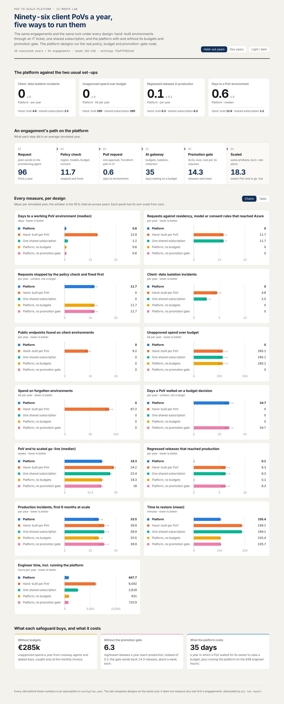

# pov-to-scale-platform

An Azure platform that takes GenAI work from a client proof of value to a scaled rollout. Every engagement gets its own isolated environment from one YAML file: network range, Azure OpenAI account, Key Vault, identity, budget and expiry date. An AI gateway enforces budgets, keeps clients apart and redacts personal data. Releases are promoted PoV → pilot → scaled only when their SLOs, eval score and cost per request pass. Consultants ask a provisioning agent in plain words; code checks the request against policy, and a platform engineer approves the pull request.

A 12-month lab runs 96 client engagements a year through five designs on the same luck. It calls the real policy, address-allocation, budget and promotion-gate code.



## Results

<!-- results:start -->
**heldout split** · 20 simulated years × 96 client engagements · mean per year ± 95% interval · settings sha256 `73a97f9821a5`

| Per year | Hand-built per PoV (ticket) | One shared subscription | Platform | Platform without budgets | Platform without promotion gate |
|---|---:|---:|---:|---:|---:|
| Days to a working PoV environment (median) (days) | 12.9 ± 0.2 | 1.2 ± 0 | **0.6 ± 0** | 0.6 ± 0 | 0.6 ± 0 |
| Requests against residency, model or consent rules that reached Azure | 11.7 ± 1.1 | 11.7 ± 1.1 | **0 ± 0** | 0 ± 0 | 0 ± 0 |
| Requests stopped by the policy check and fixed first | 0 ± 0 | 0 ± 0 | **11.7 ± 1.1** | 11.7 ± 1.1 | 11.7 ± 1.1 |
| Client-data isolation incidents | 4.6 ± 0.7 | 2.5 ± 0.7 | **0 ± 0** | 0 ± 0 | 0 ± 0 |
| Public endpoints found on client environments | 9.2 ± 1 | 0 ± 0 | **0 ± 0** | 0 ± 0 | 0 ± 0 |
| Unapproved spend over budget (k€ per year) | 285 ± 45.9 | 285 ± 45.9 | **0 ± 0** | 285 ± 45.9 | 0 ± 0 |
| Spend on forgotten environments (k€ per year) | 87.2 ± 7.1 | 0 ± 0 | **0 ± 0** | 0 ± 0 | 0 ± 0 |
| Days a PoV waited on a budget decision | 0 ± 0 | 0 ± 0 | **34.7 ± 4.1** | 0 ± 0 | 34.7 ± 4.1 |
| PoV end to scaled go-live (median) (weeks) | 24.2 ± 0.7 | 22.4 ± 0.5 | **18.3 ± 0.6** | 18.3 ± 0.6 | 18 ± 0.6 |
| Regressed releases that reached production | 6.2 ± 0.8 | 6.2 ± 0.8 | **0.1 ± 0.1** | 0.1 ± 0.1 | 6.2 ± 0.8 |
| Production incidents, first 6 months at scale | 38.9 ± 4.5 | 38.9 ± 4.5 | **33.5 ± 3.8** | 33.5 ± 3.8 | 38.9 ± 4.5 |
| Time to restore (mean) (minutes) | 189 ± 4.8 | 189 ± 4.8 | **105 ± 3.3** | 105 ± 3.3 | 106 ± 2.5 |
| Engineer time, incl. running the platform (hours per year) | 6,092 ± 179 | 2,618 ± 145 | **848 ± 41.9** | 831 ± 41.2 | 721 ± 26 |

The dev split (10 years) agrees: the platform has 0 isolation incidents and €0k unapproved overspend a year, against 3.8 and €222k for hand-built environments.
<!-- results:end -->

Every rate in `config/lab.yaml` is an assumption for a consultancy AI lab, not a measurement of any real firm. Full tables: [reports/RESULTS.md](reports/RESULTS.md). The dashboard (`dashboard/`, React + Framer Motion) reads the same results.

## How an engagement runs

```
"PoV for client Northwind Auto, gpt-4o and embeddings, €12k, 8 weeks, Frankfurt, client data"
        │  pts agent (model reads, code decides)
        ▼
engagements/northwind-auto-pov.yaml ── policy check: region, models, data class, duration, budget, consent
        │  pull request, one approval, CI: pts check · terraform validate · Checkov
        ▼
Terraform: rg-eng-… · vnet 10.64.4.0/22 peered to the hub · Azure OpenAI (Entra only, private endpoint)
           Key Vault · workload identity (this account only) · budget with expiry · diagnostics to Log Analytics
        ▼
Argo CD ApplicationSet: namespace eng-…, overlay pov ─▶ pilot ─▶ scaled (PreSync promotion gate)
        ▼
AI gateway behind API Management: caller ∈ engagement · model deployed · redaction · budget 80% / 100%
                                   · TPM limit · fallback on 429/503 · metrics → burn-rate alerts → pts triage
```

```
$ pts agent "PoV for client Acme, gpt-4.1, €10k, 6 weeks, Frankfurt, personal data" --owner … --cost-center …
### Request not provisioned
- `PTS002` gpt-4.1 is not deployed in germanywestcentral; available: gpt-4o, gpt-4o-mini, text-embedding-3-large
- regions with all requested models: swedencentral
```

## Layout

| Path | What |
|---|---|
| `src/pts/engagement.py`, `policy.py`, `ipam.py`, `render.py` | Engagement model, policy rules PTS001–011 and static Terraform rules TF001–007, address allocation, Terraform variables |
| `src/pts/agent.py` | Provisioning agent: rules or model extraction, policy, allocation, PR body, suggestions when refused |
| `src/gateway/` | FastAPI AI gateway: caller isolation, redaction, budgets, token-rate limits, fallback, Prometheus metrics |
| `src/pts/gate.py` | Promotion gate, from a metrics file or straight from Prometheus |
| `src/pts/slo.py`, `config/slo.yaml` | Multi-window, multi-burn-rate alert rules, generated |
| `src/pts/triage.py`, `runbooks/` | Read-only incident note: causes from gateway counters, runbook steps, read-only checks |
| `src/pts/lab/` | 12-month simulation, dev and held-out years, generated reports |
| `infra/terraform/` | `modules/hub`, `modules/engagement`, `envs/lab` (azurerm 4.x) |
| `deploy/k8s/`, `deploy/argocd/` | Kustomize base, pov/pilot/scaled overlays, production component (PDB, gate), ApplicationSet + AppProject |
| `dashboard/` | React + Vite + Framer Motion, feature folders, loading/error/empty states |

## Security

- **Isolation by construction.** Own Azure OpenAI account and Key Vault per engagement, Entra ID only (no keys), private endpoints, NSG allowing the hub only, AKS namespace with NetworkPolicy, workload identity scoped to that account, Argo CD project limited to `eng-*` namespaces. The gateway refuses a caller who is not on the engagement.
- **Data.** EU regions for internal and client data; fine-tuning on client data only with consent; regex redaction of emails, phone numbers, IBANs, card numbers and tax IDs before prompts leave the gateway for confidential and client-restricted work; Azure OpenAI outbound access restricted.
- **Checks.** `pts check` (policy + static Terraform rules), Checkov (0 failures; 6 skips, each with a reason), `terraform validate` in CI, `kubeconform`, `promtool test rules`.

## Tests

- Python: 51 pytest cases. They cover the policy rules, address allocation, gateway isolation, redaction, budgets, rate limits and fallback, the promotion gate (from file and from Prometheus), the agent (including a prompt-injection case), triage, lab determinism and ablations, and generated-file freshness.
- Prometheus: rule unit tests. 10% errors page within the hour; 0.2% stays quiet.
- Dashboard: 4 Vitest cases for the loading, error/retry, empty and table states.

## Run it

```bash
pip install -e ".[dev]" && pytest -q
pts check && pts render-all --check
uvicorn gateway.app:demo --factory --port 8080      # gateway with the sample engagements and a fake model
pts lab sim --split dev && pts lab report
cd dashboard && npm ci && npm run build && npx vite preview
```

## Limits

- **Simulated lab.** The engagement mix, failure rates, people's slips and durations are assumptions in `config/lab.yaml`; the lab shows how the designs differ on the same luck.
- **Not applied to a live Azure subscription.** The Terraform is validated (`fmt`, `validate`, Checkov) but has not been applied; azurerm argument names were checked by `terraform validate` in CI, not by a real deployment. The gateway is tested against a fake model backend.
- **Redaction is pattern-based.** It catches structured identifiers, not names or free-text descriptions of people.
- **Own project.** Built as a portfolio project, not at an employer.

## License

MIT © 2026 Manoj Kumar Prakash
